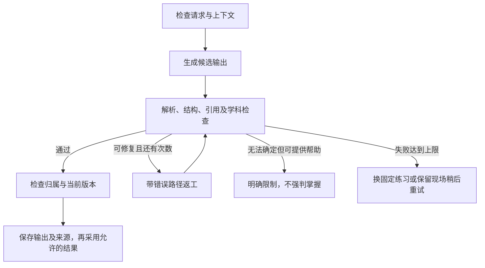

# AI 学习输出规范与自动检查／返工流程

版本：`learning-contract-v2`。日期：2026-10-31。v2按用户最新要求收窄：完整检查／返工工作流仅用于测验生成，取代v1对所有结构化输出的宽泛要求。

状态：已接通本地P1，未部署公網。测验生成机器契约及有限返工由 `server/quiz-contract.ts` 执行，快速路径由 `server/studio.ts` 与既有聊天接口分开处理。以下标明首版已支持范围与后续扩展要求；实际证据见 [P1验证](p1-verification.md)。对应范围见 [P1 实施清单](p1-learning-platform-plan.md)，决策见 [C38–C45](product-plan.md)。

## 1. 用途与单一来源

目标是按用途平衡测验质量与日常辅导速度。只有测验生成使用「生成 → 检查 → 失败返工 → 通过后采用」。普通聊天、导读后的随堂exercise及其他学习辅助不套用这条完整管线。

- **快速文字路径**：普通聊天、讲解、导读、写作建议、总结及计划解释，以一次模型回复为主，不自动追加审核模型或格式返工。
- **单次结构化路径**：确需保存字段的错因、参考反馈、技能标签等，一次模型调用后做本地类型／引用／范围检查；失败保留可用文字或不更新相应字段，不启动测验生成返工链。
- **测验生成路径**：只有生成拟用于独立测验的题目集合才使用完整契约、学科检查与有限返工。不能只在prompt里要求自检，也不能由客户端绕过。
- 所有路径继续有身份、大小、取消和写入权限等基本代码检查；这些检查不增加模型回合，不等于完整工作流。
- 判断依据是用途，不是是否返回JSON、题目数量或在哪个页面发起。导读中问一道题属于快速练习；明确进入测验模式时才切换路径。
- 机器契约与提示词保留版本，已经作答的测验题保留原题及评分依据。格式限制不得无差别套用到快速自然语言回复。

### 1.1 已确认的请求分类与边界

下表的用途分类已获用户确认。完整工作流仅用于AI生成独立测验题组：初次摸底、单元测验、独立复测及明确进入测验用途的每日小测；模拟卷生成也按此处理，但功能本身仍属后续。普通聊天、导读后附带的小测试及其他辅导请求不进入完整工作流。

| 请求用途 | 路径 | 完整自动返工 | 当前情况 |
| --- | --- | --- | --- |
| 聊天、追问、提示、解释、翻译、写作思路 | 快速文字 | 否 | 真实聊天接口已有，能否生成取决于模型配置 |
| 导读及导读后的随堂练习、聊天内临时出题 | 快速文字或单次结构化 | 否 | 自主辅导入口接通导读预填与快速随堂题，需真实模型 |
| 作答点评、作文建议、错因候选 | 快速文字或单次结构化 | 否 | 单次参考反馈及原错因检查已接通 |
| 参考评分、技能标签／暂定状态建议 | 单次结构化 | 否 | 评分经本地检查，暂定状态由代码计算，学生可质疑排除 |
| 笔记摘要、回忆卡、双周报告文字表述 | 快速文字，必要时单次结构化 | 否 | 当前保存摘要不等于调用AI生成摘要；双周AI表述尚待实现 |
| 日历方案解释／学习建议 | 快速文字或单次结构化 | 否 | 计划解释已有；实际任务约束由代码执行 |
| 初次摸底、单元测验、独立复测的题目生成 | 测验生成 | 是 | `/studio/quizzes` 的 assessment＋ai 路径已接通，fixed路径不调用AI |
| 每日复习中的计分／独立提交小测生成 | 测验生成 | 是 | 与翻卡、讲解后的随堂题区分，不按“每日复习”页面一刀切 |
| 测验提交后的判分／反馈 | 客观代码，主观单次结构化／文字 | 否 | 生成测验题的工作流不重复套到每道答案的反馈上 |
| 连接测试、模型列表 | 单次测试／读取API | 否 | 已有；模型列表读取本身不是文本生成 |
| 上传试卷OCR、资料标签、跨页提取 | 后续单次结构化／按材料处理 | 否，不直接套测验返工 | 仍为后续方向，不能当已实现 |

统计报告数字、预算、日期冲突、课程计分及从固定题库选题通常由代码完成，本身不必调用AI。

完整返工只能由测验生成入口调用，不能放进所有用途共用的底层模型调用。快速请求默认一次生成，不因包含题目、JSON或可保存字段就自动增加审核回合；学生主动要求重新解释／重新生成属于新的请求。

## 2. 输出类型

| kind | 用途 | 不应混入的行为 |
| --- | --- | --- |
| `quiz-generation` | 生成供独立测验使用的题目集合，含内部答案／评价依据，完整工作流只用于此用途 | 将聊天或导读随堂练习自动升级为测验 |
| `exercise` | 日常随堂题、聊天内原创练习；默认快速，需保存字段时只做本地检查 | 冒充历届原题、官方等级或已人工审校题 |
| `feedback` | 对指定作答的评价、依据、候选错因及下一步建议 | 改写学生原答案、直接改变整科成绩或大学目标 |
| `study-note` | 学习解释、提示、摘要与回忆内容 | 将阅读完成、自评或提示后答对当成独立掌握 |
| `plan-explanation` | 解释代码已生成的任务与取舍 | 在说明文字中新增、删除或执行日历任务 |
| `chat-text` | 一般学习聊天的文字回复 | 绕过结构化检查写入机器状态 |

kind描述内容类型，另由服务端purpose选择处理路径；返回结构化字段不代表必须返工。`quiz-generation`使用下面的严格契约；其他类型只在需要写入字段时采用相应最小结构，纯展示内容可直接返回文字。

第3节区分测验严格契约与其他用途的最小字段检查，第4–5节的完整检查／返工只用于测验生成。可复用便宜的本地检查，但不能因此为其他用途自动增加模型审核、重写或循环等待。

## 3. 首版测验生成机器字段

| 字段 | 要求与检查 |
| --- | --- |
| `contractVersion` | 必须等于本次请求指定的契约版本。未知版本不静默兼容。 |
| `items` | 严格等于本次要求的1–5题；根物件只允许contractVersion与items。 |
| item的 `skillId` | 单个本次允许技能ID，不能自行创建节点；首期AI数学数值题只评quadratic-factor。 |
| item的 `kind` | choice、numeric或short；与实际字段相符。 |
| item的 `prompt`、`answer`、`explanation`、`hint`、`criterion` | 必须是有长度上限的非空文字；其他未定义字段拒绝采用。 |
| item的 `passage`、`options`、`check` | 按题型可选；check仅用于首期数学的二次方程係数与根选择。 |

科目、主题、语言参考来自本次服务端上下文，不由模型返回独立根字段。用途、来源、题数和requestId由API请求校验；完整工作流仅在purpose为assessment且source为ai时运行。模型数值题的最终题干与解析由验算后的係数生成，避免题干与验算参数讲不同方程。

以下由服务器补充，不能相信模型自行声明：学生归属、请求／输出 ID、内容版本、生成时间、模型来源、校验器版本、检查结果、返工记录、人工／自动来源标签。

### 3.0 首版格式限制

以下为工程默认值，接入时由机器契约统一执行，修改时同步版本与测试：

- 原始输出最多30,000个Unicode码点；JSON必须是对象，禁止额外拼接解释文字。最多允许剥离一层完整Markdown代码围栏，不自动修改数字、引号内容或数学符号。
- 题干最多6,000码点，材料最多12,000码点；标识符最多120码点，单段反馈最多4,000码点。长度超限要返工，不能截断后假装答案完整。
- 选择题2–6个选项，选项ID唯一，文本去首尾空白后非空且不重复；答案必须引用已有ID。
- 首版每题引用一个本次允许技能，题目及变式族ID由代码生成，不接受模型自报ID。
- 首版用时按活动估计记录；评分以每题0–100参考或null保存，须为有限数值。分项分值总和与预计时间字段属于后续扩展，未声称已接入。
- 不按长度规则替代学科检查，也不以代码围栏清理为理由对错误答案做静默“修正”。

### 3.1 测验题目集合中的item

首版必须有：题型、题干、单技能映射、内部答案、评价依据、解析及提示。材料题可附原文；生成材料标为原创。其他更丰富结构属于后续扩展。

- 选择题：选项非空、无重复，答案引用有效选项；选项 ID 与展示文本分开。
- 数值题：答案是有效数值或受支持的表达形式；单位、容差和取值范围显式定义，不能以任意字符串执行代码。
- 短答／写作题：使用评价维度、参考要点及例子，不强行要求唯一标准句子。需要材料支持的阅读题必须附材料。
- 分项分值若存在，必须非负、总和一致；它表示本次练习参考分，不得标成未经校准的 DSE 等级。
- 新题型或数学形式没有相应检查能力时，显式标为能力未覆盖；不可假装已经通过确定性验算。
- 返回学生作答用的数据必须剥离内部答案、评分要点和完整解析；显示提示或答案时记录辅助事件。

### 3.2 反馈的最小字段检查（不走完整返工）

首版以服务端已保存题目和作答发出一次批量参考评价，解析feedback阵列中的itemId、score、verdict、text及reason。ID、范围与文字字段不合格时只显示参考要点并保持未知，不调用模型返工。以下observations、dimensions等为后续扩展的推荐结构，并非已实现字段：

- `verdict`：`correct`、`partly-correct`、`incorrect` 或 `uncertain`。
- `observations`：看到的作答事实；引用学生文字或步骤时必须实际存在，不能编造。
- `dimensions`：对应题目已定义的评价维度；分值若存在须与范围、总分和 verdict 不冲突。
- `errorCandidates`：候选原因及依据，可以为空或不确定；不把失误自动归因于懒惰、焦虑等心理状态。
- `nextStep`：解释、换一道新题、补先备、复习或暂停等受支持动作。只提出建议，由应用规则决定如何采用。
- `limitations`：信息不足、步骤缺失、材料不完整或其他限制。

客观题优先由代码判定，AI不能覆盖代码已确定的答案。主观题与步骤反馈可自动继续学习，但保留「AI参考／暂定」来源。无法判断时仍可给学习帮助，不伪造确定分数。

本节用于需要结构化落库的字段检查；若失败，不写入不合格分值／标签，给出仍可使用的文字或允许学生主动重试。不得因主观反馈是JSON就自动启动测验生成的循环返工。

### 3.3 study-note、plan-explanation 与 chat-text

- 文字非空、长度在实现设定上限内，不包含未替换占位符；按普通文本／受控 Markdown 渲染，不执行模型输出的 HTML 或脚本。
- 摘要引用的材料或来源应存在；没有材料时不能自称已阅读某份试卷、图片或文章。
- 计划说明只能引用本次代码计划内的任务、时间、目标与未知项；不得凭空增加收益或声称保证升分／录取。
- 纯聊天只影响聊天记录。要改变暂定技能状态或提出日历任务，必须另走对应结构化接口与权限校验。

## 4. 每次测验生成都要经过哪些检查

| 层级 | 执行者 | 要检查什么 | 失败后如何处理 |
| --- | --- | --- | --- |
| L0 请求与上下文 | 代码 | 身份、用途、允许技能、输入范围、请求有效性与取消状态 | 输入／权限问题直接返回，不花 API 请求让模型修复 |
| L1 解析与格式 | 代码 | JSON／文本可解析、版本、必填字段、类型、枚举、长度、未定义机器字段 | 给出精确错误路径，进入返工 |
| L2 引用与内部一致性 | 代码 | 题号／技能／选项／材料引用、分项与总分、评价维度、作答引用 | 可修复的进入返工，不能擅自改原作答或原题 |
| L3 学科内容 | 代码优先，必要时AI辅助 | 支持范围内的数值／模板验算，答案与解析一致，阅读证据及写作评价可解释 | 明确矛盾则返工；无法可靠判定则保留不确定或换题 |
| L4 采用与状态更新 | 代码 | 学生归属、来源、辅助／重复情况、状态版本、允许修改的范围 | 冲突则重新读取或停止；不让模型修复权限和数据库冲突 |

格式通过只证明符合契约，不证明学科内容一定正确。首版数学係数与数值答案可代码验算；中文／英文执行结构、技能、选项及重复检查，未实现独立语义审核模型。以后如增加语义复核，其输出也要校验并受总调用上限约束。AI自称「检查通过」不是本地校验或客观验算的替代。

检查结果至少区分：

1. **可采用**：通过对应类型的必要检查；仍保留原创／AI参考等来源标签。
2. **受限可用**：可以给解释或学习建议，但证据不足，相关评价／技能状态保持不确定。
3. **拒绝采用**：格式、引用或确定性检查失败；不能作为题目、反馈或状态更新直接发给学生。

## 5. 仅测验生成的自动返工工作流



### 5.1 返工反馈

每项问题使用 `code`、`path`、`message`、`repairable`。例如：

```json
{
  "code": "ANSWER_OPTION_NOT_FOUND",
  "path": "payload.answer.optionId",
  "message": "答案引用了不存在的选项；只能引用本题已有选项ID。",
  "repairable": true
}
```

返工请求携带契约版本、最少必要的原上下文、候选输出及检查问题，要求返回完整修正版。修复后必须重跑全部相关检查，不能因为模型说「已修改」就放行。

已作答题目的题干、材料、评价依据和学生原作答不得在反馈返工中偷偷改变；题目本身有问题时单独标记／撤回，而不是改题来使既有答案成立。

### 5.2 有限重试与失败处理

以下是工程初始参数，可在真实模型验证后版本化调整，不是用户已经指定的固定金额限制：

- 每次测验生成请求默认最多三次生成尝试，即首次加最多两次返工；其他用途不继承此重试设置。
- 如有额外语义复核，所有模型调用还必须受请求级总次数与总超时约束；不能让复核再递归启动无上限返工。若不能完成必要检查则停止采用。
- 重复同一错误且没有改善时可提前停止；学生取消、身份失效、提供方认证失败、配额／限流不走内容返工。
- 达上限后优先提供同技能的可用固定练习；没有合适备用内容就保留已输入内容、说明暂未生成成功并允许稍后重试。不能把未通过输出直接展示为通过。
- 批量题目可保留已通过项目，只返工失败项；初测题数不足时说明实际覆盖，不补假结果。

不要把生成返工次数与学生补救次数混在一起。学生同一补救周期再次失败时仍按C26暂停自动追加；模型修复格式不能让学生被迫无限做题。

## 6. 暂定学习状态与记录

- AI练习与反馈可以自动用于选择下一步、暂定知识点状态及计划草稿；不要求每次等待人工。
- 普通聊天与随堂练习不因保存记录或影响推荐就自动进入完整工作流；写入字段时只做必要本地检查，来源标为相应快速学习活动。它们与独立测验的证据类型继续区分。
- 未人工审校内容不能自动标为 `reviewed`。暂定学习证据与已审校证据分开，显示来源及覆盖限制。
- 重复题、只换数值的近似题、看过答案与提示后答对保留记录，但不无限累加独立证据。
- 继续使用不同新题与跨时段复测增强判断。自评、翻卡、阅读完成是学习活动，不是等价的独立作答。
- 暂定技能状态不直接改整科DSE成绩、收生公式或学生目标；日历仍经过应用的预算／冲突／锁定规则与现有预览确认机制。
- 每次采用保留输出ID／版本、契约与检查器版本、模型来源、采用限制和返工次数。失败日志保存错误代码与必要摘要，避免记录密钥或大量重复个人文本。
- 请求需按学生隔离并可去重；重复点击、重试或过时响应不能重复计证据、重复建任务。
- 学生可标记题目／反馈有误。修正后保留原记录及原因，重新计算受影响的暂定状态；日历受影响时给出新预览，不删除已完成历史。

## 7. 接入后的必要验收用例

| 场景 | 预期结果 |
| --- | --- |
| 测验生成首次返回坏JSON，修复后合格 | 只采用修复版，记录一次返工 |
| 测验题目JSON有效但答案选项不存在、总分不一致或技能越界 | 不能直接采用，返回具体问题并返工 |
| 格式正确但数学验算发现答案错误 | 内容失败，不能以格式通过替代验算 |
| 主观答案存在多种合理解释 | 允许有依据的参考反馈或不确定，不强造唯一标准答案 |
| 连续失败、认证失败、限流、取消 | 有限停止；不生成假分，不更新知识点或日历 |
| 单次反馈引用了学生没写过的步骤 | 首版格式检查不能证明自由文字语义，学生可质疑并排除该回饋；以后若增加明确引用字段再做对应检查，不改学生原答案或启动测验返工 |
| 题目通过但客户端请求题目时包含答案字段 | 答案剥离测试失败，阻止交付 |
| 同一请求重复、旧版本响应晚到、其他学生访问 | 不重复采用；过时／越权结果不可写入 |
| 已采用内容随后被纠错 | 历史可追溯，派生暂定状态可重算，计划重新预览 |
| 普通聊天或导读后练习返回可用回复 | 单次交付，不为测验格式规则增加审核／返工调用 |
| 错因等结构化字段无效 | 本地拒绝该字段，不修改相应状态，不启动完整返工链 |
| 学生将聊天题显式转为测验 | 只有切换用途后才经过测验生成工作流；原有提示／作答记录不被抹去 |
| 比较各用途的模型调用次数 | 正常快速请求默认一次，无隐藏审核调用；测验生成才允许有限返工；固定题库选题无需模型调用 |

验证证据必须区分：替身模型失败／返工测试、真实提供方协议测试、真实内容质量抽查及学生使用测试。写好规范或通过格式测试，均不能代表后面三项已经通过。
